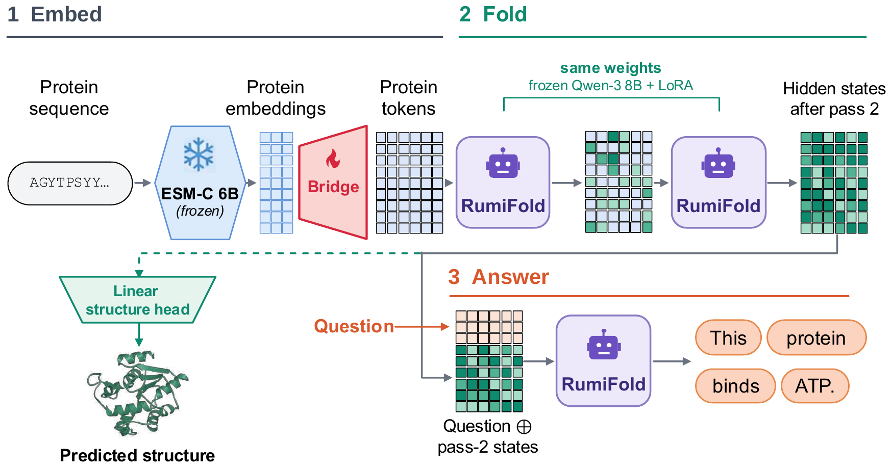

# RumiFold



RumiFold is built on Qwen3-8B. It folds a protein inside the language model's own hidden states and then answers questions about it in natural language.

1. **Embed.** A frozen ESM-C 6B encoder embeds each residue, and a trained bridge maps the embeddings into Qwen's hidden space.
2. **Fold.** Qwen3-8B (frozen, with LoRA adapters) runs over the residues twice, feeding the first pass back into the second. A linear head reads the backbone from the result.
3. **Answer.** The same model reads the text and attends to its own folding states.

This repository holds inference, evaluation and training code. Weights and data are on Hugging Face:

| | |
|---|---|
| [RumiFold_Models](https://huggingface.co/RumiFold/RumiFold_Models) | checkpoints |
| [RumiFold_GO](https://huggingface.co/datasets/RumiFold/RumiFold_GO), [RumiFold_Prot2Text](https://huggingface.co/datasets/RumiFold/RumiFold_Prot2Text) | task data with ESM-C embeddings |
| [RumiFold_Functional](https://huggingface.co/datasets/RumiFold/RumiFold_Functional), [RumiFold_Data](https://huggingface.co/datasets/RumiFold/RumiFold_Data) | functional and folding data with ESM-C embeddings |
| [RumiFold_Results](https://huggingface.co/datasets/RumiFold/RumiFold_Results) | predictions and per-target scores |

## Install

```bash
git clone https://github.com/kevinlu4588/RumiFold.git && cd RumiFold
pip install -r requirements.txt
```

Needs Python 3.12 or newer. Tested with Python 3.12 on a 48 GB GPU.

## Demo

Two proteins come with their embeddings (`examples/data`), so the demo needs only Qwen3-8B and one checkpoint. Both download on first use.

```bash
python scripts/demo.py                        # yeast lumazine synthase (RIB4, 169 residues)
python scripts/demo.py --protein lysozyme     # hen egg-white lysozyme (precursor, 147 residues)
```

What it prints (RumiFold 156k):

| | Lumazine synthase | Lysozyme |
|---|---|---|
| Active site | `A/98 His.` (right) | `A/53 Glu.` (Glu 53 is catalytic; Asp 70 is missing) |
| Function | `... 6,7-dimethyl-8-ribityllumazine synthase activity. EC 2.5.1.78.` (right) | `... lysozyme activity. Function: Not known` (right activity; no EC number or description) |
| Capital of France | `The capital of France is Paris.` | the same |

Answers about function can be wrong and are stated with the same confidence as right ones. For function, use `rumifold-go` or `rumifold-prot2text`.

Or open [examples/demo.ipynb](examples/demo.ipynb).

## Your own protein

RumiFold takes ESM-C 6B embeddings. There are two ways to get them.

**Compute them** (downloads ESM-C 6B, about 24 GB):

```bash
python scripts/make_esmc_features.py --sequence MKV... --out protein.safetensors
```

**Use ours.** If the exact sequence is in `RumiFold_GO` or `RumiFold_Functional`, this reads just that protein's embedding (a few MB), after downloading the dataset's index once:

```python
from rumifold import features_from_hub
x = features_from_hub("MKV...")               # or features_from_hub(seq, "RumiFold/RumiFold_Functional")
```

Every checkpoint reads the final layer except RumiFold-Prot2Text (L76), which reads layer 76 (`--layer 76`). Attention kernels affect the last digits: install `xformers` to get closest to the embeddings used in the paper.

## Fold and ask

```bash
python scripts/fold.py --model rumifold-156k --features protein.safetensors --sequence MKV... --out fold.pdb
python scripts/ask.py --model rumifold-156k --features protein.safetensors "Which residues form the active site?"
```

```python
from rumifold import RumiFold, load_features
model = RumiFold.from_pretrained("rumifold-156k")          # a released name, or a local checkpoint folder
fold = model.fold(load_features("protein.safetensors"))
print(model.ask("What does this protein do?", fold))
```

Residues are written as `A/57` (1-based) in questions and answers. For complexes, concatenate the chains and pass `--chain-lengths 120 95` (checked against the original code for RumiFold-Struct only).

## Checkpoints

| Name | What it is |
|---|---|
| `rumifold-95k` | folding and structural questions, with general function training; the base for the fine-tuned models |
| `rumifold-156k` | continued from 95k with more folding |
| `rumifold-go` | fine-tuned for Gene Ontology |
| `rumifold-prot2text`, `rumifold-prot2text-l76` | fine-tuned to describe protein function |
| `rumifold-struct-100k`, `rumifold-struct-174k` | folding only |

## Evaluate

| Task | Predict | Score |
|---|---|---|
| Gene Ontology | `eval/predict_go.py` | `eval/go.py` (information-weighted F1) |
| Prot2Text | `eval/predict_prot2text.py` | `eval/prot2text.py` (exact match, BLEU, ROUGE, BERTScore) |
| Folding | `scripts/fold.py` | `eval/fold.py` (TM-score, CA-lDDT, GDT-TS) |

See [REPRODUCE.md](REPRODUCE.md) for which of the paper's numbers these reproduce.

## Training

`train/trainer.py` runs the folding, replay, Gene Ontology and Prot2Text tasks, plus supplementary residue-label, GO-head and structural-question tasks: see [docs/training.md](docs/training.md).

## License

Code and weights are released under Apache-2.0. Qwen3-8B (Apache-2.0) and ESM-C 6B are separate downloads under their own licenses.
